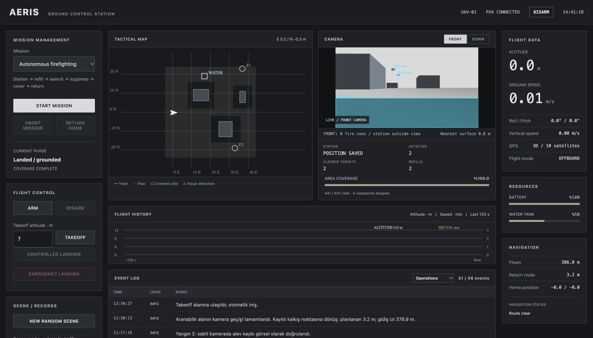
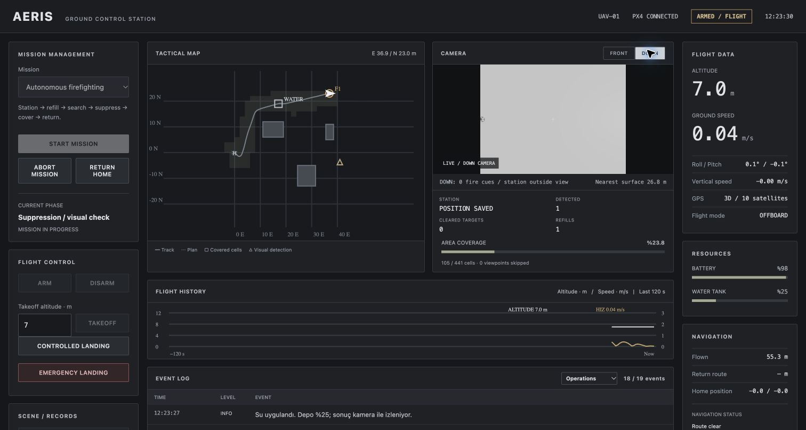
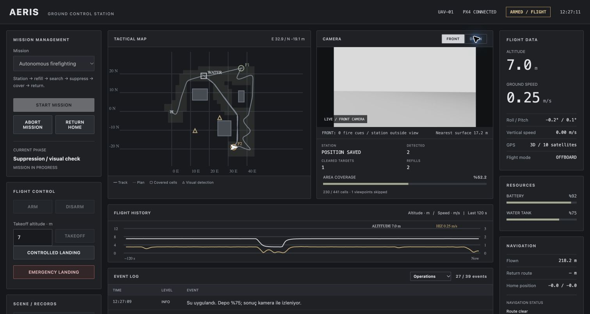
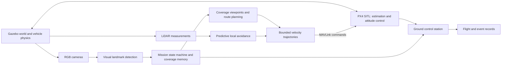
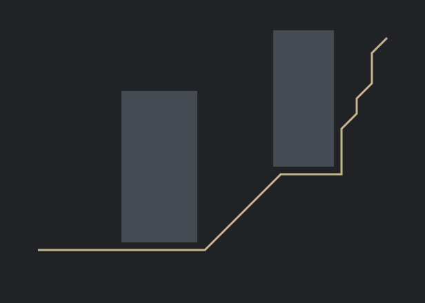

# AERIS | Autonomous UAV Firefighting

**Camera-guided search, refill, suppression and return-to-home in PX4 + Gazebo SITL.**

Developed by **Mehmet Karaman** as an independent control, computer-vision and autonomous-systems project.

> **Selective source publication:** this repository documents the full simulation project and publishes its core simulation algorithms and independent analysis examples. The core simulation algorithms, Kalman/windowing implementation and PX4/Gazebo bridge are now published in [flight-algorithms](flight-algorithms). Platform-specific runtime configuration, dashboard assets, binaries and raw records remain local. This is not a turnkey release of the complete application.

[Watch the mission recording](aeris-mission.mp4) · [Recorded benchmark results](benchmark-results.json) · [Public code samples](#public-code-samples)

[](aeris-mission.mp4)

*Actual Gazebo-rendered footage of a PX4 SITL flight. The video contains four edited 10-second excerpts; the elapsed telemetry time is shown in the frame. It is not a continuous full-mission recording. The external chase camera is for presentation only and supplies no information to the autonomous mission.*

## Published flight algorithms and filtering

[Browse the algorithm source and tests](flight-algorithms) · [Terrain-aware antenna study](antenna-analysis)

The public algorithm snapshot includes constant-velocity **Kalman tracking**, **3-of-5 temporal detection windowing**, LiDAR motion prediction, local avoidance, trajectory shaping, A* routing, camera coverage, set-cover/2-opt planning, the search/refill/suppression mission state machine, classical perception and the direct MAVLink/PX4 SITL bridge. It also includes the separate Gazebo world-effects and traffic scripts. **MAVROS is not used.**

The published copy passed **59 tests** in the configured project environment. A separate synthetic Kalman experiment reduced position RMSE from 0.404 m to 0.162 m; this is not a flight-performance result. The recorded v0.7 mission benchmark below predates the filtering update.

The English [antenna analysis](antenna-analysis) compares seven antenna arrangements in four terrain profiles with frozen station layouts and independent test samples. Executed notebook outputs, Python code, charts and machine-readable findings are included.

## Neural perception extension: YOLOv8n

A two-class YOLOv8n marker detector runs alongside the original OpenCV camera pipeline. It detects **fire markers** and **water-station markers**, reports confidence and bounding boxes, and projects fresh observations using capture-time vehicle attitude/position. A separate process and latest-frame queue keep inference off the camera callbacks; expired observations are discarded. The existing LiDAR Kalman tracker continues to estimate obstacle motion independently.

**Why add it?** The original detector depends on hand-written color/shape rules. This pilot adds a trainable detection interface and measured neural-versus-classical comparison, providing a path to training on a larger, labelled camera dataset. It has not demonstrated real-fire generalization or better flight performance.

On 48 independently generated procedural marker images (71 objects, IoU >=0.5), the original detector matched 68 objects with one false positive; YOLO matched 71 with zero false positives at confidence >=0.45. Median local call times were approximately 0.31 ms and 12.30 ms respectively. These are narrow synthetic-image results, not Gazebo mission or real-camera results. The system remains in **shadow mode**: YOLO overlays/telemetry are visible, while established camera detections continue to control mission decisions.

The local suite passed **59 tests**. A separate integration check injected RGB images through the Gazebo Image callback and verified fresh YOLO output, metric projection and preserved classical detections; no new autonomous flight was claimed. [Read the implementation, training procedure and limitations](flight-algorithms/YOLO.md).

## The mission

The UAV begins with an empty water tank and no knowledge of the station location, fire locations or fire count. It must:

1. Take off and search for the water station using camera observations.
2. Record the visually estimated station position and perform a controlled refill approach.
3. Search for fires, approach a confirmed target and apply the simulated water payload while hovering.
4. Verify suppression from sustained absence of the flame marker in fresh camera images.
5. Return to the remembered station when water is insufficient, then resume the mission.
6. Preserve coverage already obtained by the camera and inspect only remaining unobserved areas.
7. Return to the recorded launch location only after full defined-area coverage and no known active fire, then land.

Static structures constrain the route. Moving aerial actors create sensor-visible traffic around the search area. The vehicle responds to LiDAR measurements rather than receiving actor coordinates from the world service.

## Ground control station

### 1. Fire response and visual inspection



The operator sees the mission phase, camera stream, perceived targets, water level, altitude, speed and coverage. Fire and station positions enter the map after visual observations; their true locations are not preloaded into the mission controller.

### 2. Resource management and continued search



The same mission memory survives target diversions and station visits. A low water level triggers a refill trip without erasing already observed ground cells. The route and live vehicle trace are shown separately.

### 3. Coverage completion and return


Completion requires the entire defined navigable search area to be observed. A vehicle passing near a cell does not, by itself, mark that cell as covered. The screenshots use an English display translation of the live GCS; numeric values and flight state are unchanged. They are taken during the demonstration recording, separately from the benchmark run below.

## System architecture



The world-effects process owns hidden fire and station placement. It applies simulated refill/suppression effects and returns acknowledgements. It does not provide target positions or counts to the navigation logic. World truth is used only for simulation contact effects and post-flight validation, not to discover targets.

## Engineering approach

| Area | Implementation in the full project |
|---|---|
| Vehicle physics and autopilot | Gazebo Harmonic 8.10.0, PX4 SITL, X500 quadrotor |
| Camera processing | Python/OpenCV colour-and-shape landmark detection, ground projection, repeated-observation confirmation |
| Search coverage | 441 navigable 2 × 2 m cells; full-cell camera visibility confirmed in three distinct fresh frames |
| Efficient scanning | Camera-footprint set cover, obstacle-aware route distances and 2-opt refinement; skip viewpoint visits when their coverage has already been obtained |
| Transit and return | Euclidean A* visibility graph around known structure footprints; return from current position to recorded home |
| Dynamic avoidance | LiDAR track-based prediction, committed passing side and temporary detour routes |
| Motion commands | Bounded horizontal acceleration and jerk; PX4 IMU/gyro-based attitude control |
| Water cycle | Empty-tank start, visual station acquisition, controlled refill at 3 m and suppression hover near 7 m |
| GCS | Live map, front/down video, vehicle instruments, water/coverage counters, flight history and structured event logs |
| Failure handling | Controlled hold on brief stale data; incomplete/aborted outcomes instead of fabricated completion |

The full route planner is a practical heuristic. A* optimizes paths on its defined graph; the combined coverage strategy is not claimed to be globally optimal.

## Recorded validation results

The table reports **one controlled v0.7 benchmark run** against the earlier successful v0.6 run, using the same fire/station layout. The full-rate flight logger provides distance. Dynamic traffic encounters and physical flight traces can differ between runs. The showcase video is a separate demonstration flight.

| Metric | Earlier planner (v0.6) | Coverage-aware planner (v0.7) |
|---|---:|---:|
| Observed search cells | 441 / 441 | 441 / 441 |
| Visually confirmed suppressed fires | 2 | 2 |
| Refills | 2 | 2 |
| Flown horizontal distance | 692.8 m | 413.2 m |
| Mission duration | 895.7 s | 569.3 s |
| Landing error from launch location | 0.42 m | 0.35 m |

In this run, distance decreased by **40.4%** and duration by **36.4%**. Coverage never decreased during the mission. Six viewpoint visits were skipped after their cells had already been observed. Post-flight world auditing confirmed that both simulated fires were suppressed; those hidden locations were not supplied to the mission controller.

The full project passed **41 automated regression tests** at this version. The **six public sample tests** in this repository are a separate, smaller suite and do not reproduce validation of the full integrated simulation.

The bundled [sanitised telemetry sample](sample-telemetry.csv) contains local relative positions and selected signals at approximately 1 Hz. It excludes absolute GPS coordinates, private paths and event internals. Its sampled path-length approximation is expected to differ slightly from the full-rate flight logger.

## Public code samples

These examples demonstrate selected ideas without exposing the complete application. **They cannot control a vehicle or reproduce the complete AERIS mission.**

| File | Purpose |
|---|---|
| [astar_demo.py](astar_demo.py) | Independent static-grid A* example with Euclidean costs and no diagonal corner cutting; produces `route.svg` |
| [telemetry_report.py](telemetry_report.py) | Standard-library analysis of the sanitised recorded flight sample |
| [test_samples.py](test_samples.py) | Route feasibility, corner constraints and telemetry analysis tests |
| [sample-telemetry.csv](sample-telemetry.csv) | Approx. 1 Hz observations from the recorded v0.7 benchmark flight |
| [benchmark-results.json](benchmark-results.json) | Recorded benchmark metrics and provenance |

Python 3.9+; no third-party Python dependencies are required for these samples:

```bash
python astar_demo.py
python telemetry_report.py
python -m unittest -v test_samples
```

The grid demo is deliberately simpler than the full visibility-graph planner. It does not contain dynamic avoidance, mission logic, PX4 interfaces or the camera pipeline.



## Scope and limitations

- This is a **simulation-based engineering project**. No physical UAV flight is claimed.
- Fire detection uses controlled visual markers, not a trained real-world fire detector.
- Water refill and suppression are abstract simulation effects, not fluid, pump or thermal physics.
- Moving traffic consists of kinematic Gazebo actors, not a fleet of independent PX4 aircraft.
- Coverage applies to the defined navigable ground cells outside building safety footprints; it is not proof of visibility of every surface or real-world fire.
- The scene does not spontaneously ignite new fires. A persistent deployment would require observation-age policies and periodic rescanning.
- A single successful run and this comparison do not establish a general reliability or safety certification.

## Source availability

Published source now includes the [core flight algorithms and tests](flight-algorithms), the [standalone antenna analysis](antenna-analysis), the original educational samples and selected presentation assets. Local platform configuration, dashboard application assets, binaries, raw logs, scenario audits and personal paths remain unpublished. The complete local application and installation are not provided as a turnkey package. See the [publication notice](NOTICE.md). Public visibility is not an open-source licence.
