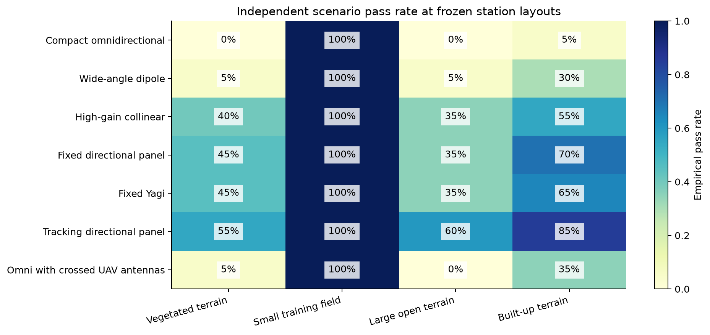
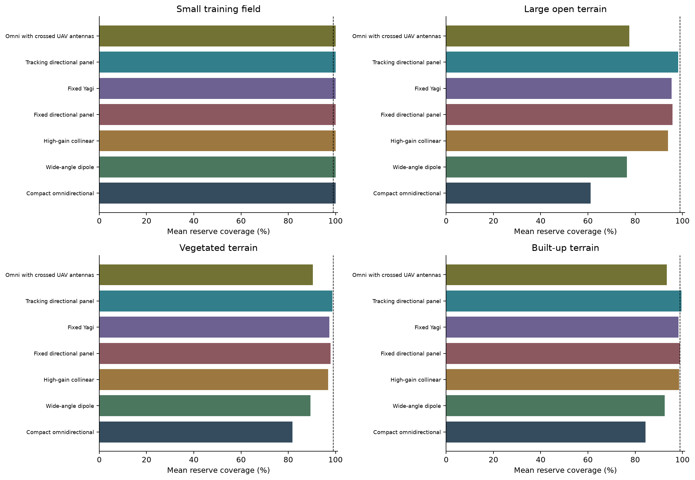
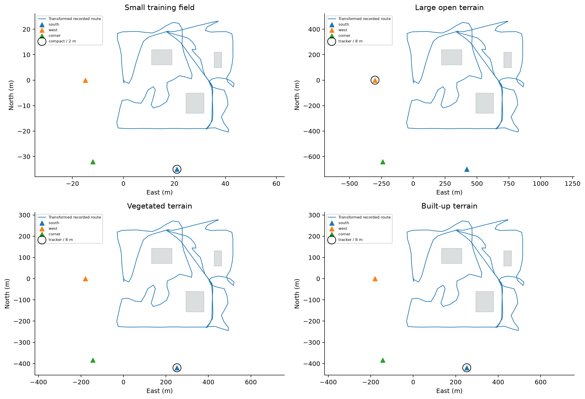

# Terrain-Aware Antenna Comparison

A self-contained antenna-family comparison for the AERIS autonomous firefighting UAV project.

[Open the executed notebook](antenna-terrain-study.ipynb) · [Python analysis](antenna-terrain-study.py) · [Detailed results](terrain_comparison.csv)

## Which antenna is useful in each terrain?

Seven idealized configurations were compared across four terrain profiles, three routes, three station locations and two mast heights. There are **10,080 selection link calculations and 1,680 independent test link calculations**. Each test sample must satisfy the criterion on all three routes.

| Terrain | Highlighted antenna family | Independent scenario pass rate | Mean reserve coverage | Interpretation |
| --- | --- | ---: | ---: | --- |
| Small training field | **Compact omnidirectional** | 100% | 100.00% | Broad angular coverage with the simplest arrangement. |
| Large open terrain | **Tracking directional panel** | 60% | 98.25% | Tracking keeps directional receive gain aligned over a wide moving mission. |
| Vegetated terrain | **Tracking directional panel** | 55% | 98.64% | Directional tracking offers the strongest relative result under modeled vegetation and shadowing. |
| Built-up terrain | **Tracking directional panel** | 85% | 99.61% | Tracking and station placement perform best together under the assumed building geometry. |

The small-field omni was chosen by simplicity among configurations meeting the selection criterion. For the other terrains, the tracking panel was the strongest **relative performer** among the tested arrangements. These results do not claim that it meets every operational requirement or that it is the best commercial antenna for arbitrary terrain. The pass rates above preserve that distinction.



## Why the families behave differently

Compact omni / dipole: broad angular coverage suits nearby, changing flight directions. Low installation complexity makes this family useful for a small training field. Collinear: higher horizontal gain trades against narrower vertical coverage. Altitude and relative station geometry therefore matter.

Fixed panel / Yagi: useful when the route remains inside the beam. A predefined fixed pointing direction can lose alignment during perimeter search or return legs. Tracking panel: follows delayed vehicle directions and provides directional receive gain. This helped the weaker UAV-to-ground direction in the larger tested environments. Tracking error and short freezes are explicitly included.

Crossed UAV antennas: ideal branch selection can reduce pose-related nulls, but the switching loss and terrain geometry affect the net result. It is not assumed to provide MIMO or combining gain.



## Station placement is part of the comparison

Station choices are selected using seeds 0–19 and frozen before evaluation on seeds 100–119. Each antenna is evaluated at its selected station layout. The comparison is therefore between complete antenna-and-placement arrangements, not an isolated measurement of antenna gain. Independent test results do not change the selected layout or highlighted family.



## Method and assumptions

Local position/attitude samples come from a completed **Gazebo/PX4 simulation**, not physical flight. Absolute GPS coordinates are excluded. Recorded geometry is transformed for sensitivity studies. Perimeter and out-and-back routes are synthetic.

Seven parametric patterns are compared; measured product radiation patterns are not used. Nominal frequency is 868 MHz; peak EIRP is 20 dBm at the station and 10 dBm at the UAV. Receiver sensitivity, cable/installation loss, antenna-gain variation, beamwidth and shadowing vary across shared random samples.

A delayed tracking model, 3D dipole-axis pose loss and ideal crossed-antenna branch selection are included. Full polarization coupling, chassis coupling and servo dynamics are omitted. Building/vegetation attenuation is derived from intersections with assumed 12 m rectangular obstacles. Coefficients are declared sensitivity assumptions, not measured material properties.

Reserve coverage measures time with at least 10 dB link margin. A scenario passes when all three routes achieve at least 99% reserve coverage, at most 0.1% modeled outage and no continuous outage longer than 3 s. Outage is a signal-threshold result, not actual packet loss. The 180-sample route grid limits temporal resolution. The study does not solve multipath, exact diffraction, interference, modem throughput or video capacity.

## Reproduce

Python 3.10+ with NumPy, pandas, Matplotlib and IPython:

```bash
pip install -r requirements.txt
python antenna-terrain-study.py
```

Alternatively, run all cells in the notebook on Kaggle or Jupyter. No external dataset download or GPU is required. Generated files are written to `antenna_results/` locally, or `/kaggle/working/antenna_results/` on Kaggle. The notebook already includes recorded outputs for inspection on GitHub. All analysis code comments have been removed; method explanations are provided here and in English notebook sections.

Internal checks cover disjoint selection/test seeds, experiment counts, finite outputs, reference free-space attenuation and exact response to a controlled additional path loss. These checks establish implementation consistency, not field validation.

## Files

| File | Purpose |
| --- | --- |
| `antenna-terrain-study.ipynb` | Executed, self-contained English notebook |
| `antenna-terrain-study.py` | Same reproducible calculations as a Python script |
| `terrain_comparison.csv` | All seven arrangements in all four terrain profiles |
| `terrain_findings.json` | Machine-readable terrain findings for a future interface |
| `requirements.txt` | Analysis dependencies |
| Three PNG figures | Pass-rate, coverage and station-layout comparisons |

## Sources

[ITU-R P.525](https://www.itu.int/rec/R-REC-P.525-5-202411-I/en) supports the free-space attenuation expression. [ArduPilot antenna tracking](https://ardupilot.org/copter/docs/common-antenna-tracking.html) describes the directional tracking concept. [This Taoglas collinear datasheet](https://www.taoglas.com/datasheets/OMB.868.B10F21.pdf) illustrates a real antenna family; its measured pattern is not used in these calculations.

Only this standalone analysis, sanitized simulation geometry and figures are published. The core simulation source is available in [flight-algorithms](../flight-algorithms); local runtime configuration, raw records and application assets remain unpublished. This analysis cannot command a vehicle.
