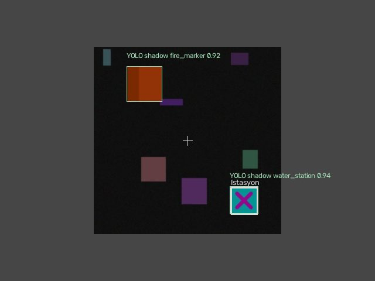

# YOLOv8n simulation-marker perception pilot



This image is a procedural test scene, not a real fire or a captured Gazebo flight. The live pipeline now supports trained YOLO detection on both camera channels. The default operating mode is **shadow**: it adds neural boxes, confidence and timing telemetry alongside the existing classical detector. It does not issue commands, confirm mission targets, override suppression checks or replace LiDAR avoidance.

## Why this extension exists

The original OpenCV detector uses fixed HSV color masks and a station cross-shape check. It is inexpensive and appropriate to the current controlled markers, but adding classes or learning appearance variation requires a trainable detector. YOLOv8n provides that interface with a small model. This pilot demonstrates training, asynchronous inference and integration rather than claiming robust real-world fire detection.

COCO weights alone do not supply the two required classes. The worker rejects weights unless their class names are exactly `fire_marker` and `water_station`. The custom pilot starts from official YOLOv8n pretrained weights and fine-tunes for these synthetic classes.

## Architecture

1. Each RGB camera callback submits a frame copy, camera identity, capture time and capture-time vehicle telemetry.
2. A latest-frame slot per camera prevents an unbounded queue. A separate Python process loads the model once, isolating PyTorch/Ultralytics dependencies from the Gazebo environment.
3. The worker uses 320-pixel inference, confidence 0.45 and IoU/NMS 0.5, returning class, confidence, box and measured inference time.
4. Responses older than 0.8 s are not displayed/projected. Invalid boxes, unsupported classes and invalid ground intersections are rejected.
5. A camera ray projects the box center onto the same assumed marker planes used by the classical pipeline. These are approximate marker coordinates, not monocular depth estimation.
6. The panel shows `YOLO shadow: ready` and a separate labeled overlay. API data are under `vision.yolo`, including fresh per-camera detections and `mission_authority: false`.

An unavailable model, missing optional environment, initialization failure, timeout or worker exit is visible in status/error fields and leaves the original mission detector operational. No automatic model downloads occur during flight. A frozen worker cannot block the camera callback. This optional worker is not a replacement for PX4 estimation or the existing LiDAR Kalman filter.

## Training and evaluation

The dataset builder produces 240 train, 48 validation and 48 test images with independent seeds 42, 10042 and 20042. It draws colored box-like fire markers and cyan/magenta station markers on varied procedural backgrounds, including empty images, clutter, scale, brightness and blur. These are not physical flames, Gazebo renders or manually annotated real-camera data. Model augmentation adds flips, rotation, perspective and mosaic. Eighteen epochs were run using seed 42, 320-pixel images, batch 16 and MPS; the best validation checkpoint was used for the separate test set.

At IoU >=0.5, on the same 48 test images with 71 labelled objects:

| Detector | True positives | False positives | Misses | Precision | Recall | Median local call time |
| --- | ---: | ---: | ---: | ---: | ---: | ---: |
| Original HSV/shape | 68 | 1 | 3 | 0.9855 | 0.9577 | 0.31 ms |
| YOLOv8n pilot, confidence >=0.45 | 71 | 0 | 0 | 1.0000 | 1.0000 | 12.30 ms |

The YOLO validator separately reported mAP50 0.995 and mAP50–95 0.9325. Its batch-validation forward timing was 40.13 ms/image; this differs from the single-image comparison's median because the measurement procedures and batch sizes differ. A subprocess smoke check measured one request submission at 0.033 ms and one inference at 20.91 ms. These local measurements are not worst-case latency guarantees. See [raw comparison](detector_comparison.json) and [validator metrics](pilot_metrics.json).

The result supports a working neural marker pilot and finds fewer misses on this narrow generated test set, at greater computational cost. It does **not** show better full-mission completion, illumination robustness in Gazebo, real-fire recognition or reliable generalization. The generator's simple marker distribution makes this an easy benchmark. A labelled Gazebo/camera dataset, hard-negative scenes, camera/mission-level held-out splits, varied viewpoints and occlusion are required before promoting YOLO from shadow mode to mission authority. Water-station and fire-marker classes are simulation-specific.

## Run locally

Create a separate environment so the Gazebo Python/native ABI is unchanged:

```sh
python -m venv .yolo-venv
.yolo-venv/bin/python -m pip install -r requirements-yolo.txt
.yolo-venv/bin/python yolo_build_dataset.py
.yolo-venv/bin/python yolo_train_markers.py
export AERIS_YOLO_PYTHON="$PWD/.yolo-venv/bin/python"
export AERIS_YOLO_WEIGHTS="$PWD/runs/markers/weights/best.pt"
```

The training example uses `device='mps'`; choose a supported device for your machine. Training downloads official pretrained weights. For local CPU inference the supplied worker selects `cpu`. The public source includes the dataset builder and training/evaluation scripts, but the trained local binary and full runtime setup are retained in the private archive. The owner-local launcher automatically discovers `work/aeris-yolo/.venv/bin/python` and `models/yolo/markers.pt`. Restart the existing local panel/session after landing to load the updated camera code.

`yolo_detection.py`, `yolo_worker.py` and the updated `vision.py` implement inference and integration. `test_yolo_detection.py` covers schema filtering, projection, stale frames and missing weights. The updated local project suite passed 59 tests; callback/subprocess checks used injected test images, not a new flight. A legacy showcase screenshot/video predates YOLO and is not evidence of this extension.

Implementation references: [Ultralytics YOLOv8](https://docs.ultralytics.com/models/yolov8/) and [custom training](https://docs.ultralytics.com/modes/train/). Ultralytics and pretrained/derived models retain their upstream licensing terms; this repository does not grant a new license for those dependencies.
